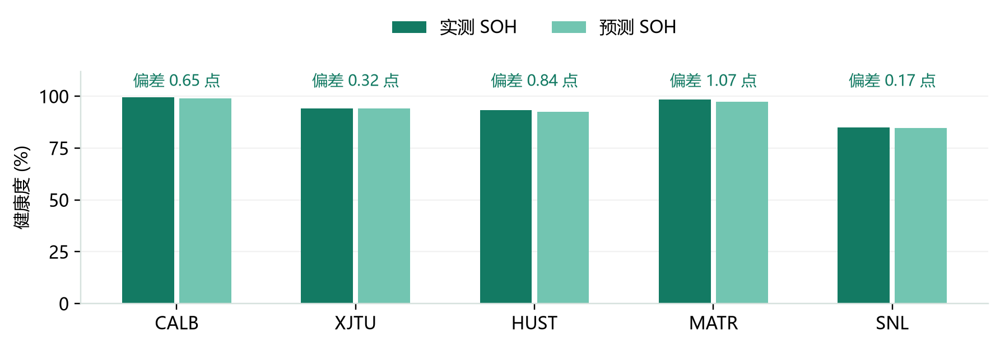

# 电检通：多数据集案例报告

五个来源，每个来源10题，共50个案例。

这50题的SOH平均绝对偏差为 **0.61 个百分点**；30个可评分寿命样例的平均相对偏差为 **6.34%**。

所有统计结果仅对应本报告内案例。

[查看排版PDF](电检通_多数据集案例报告_50题.pdf)

| 来源 | 类型 | 样例 / 电芯 | SOH平均偏差（点） | 寿命平均相对偏差 |
|---|---|---:|---:|---:|
| CALB | 三元锂 | 10 / 4 | 0.647 | 无足够终点，仅展示SOH |
| XJTU | 三元锂 | 10 / 5 | 0.317 | 无足够终点，仅展示SOH |
| HUST | 磷酸铁锂 | 10 / 4 | 0.842 | 6.88% |
| MATR | 磷酸铁锂 | 10 / 6 | 1.069 | 9.98% |
| SNL | 磷酸铁锂 | 10 / 1 | 0.172 | 2.15% |

## CALB：10个案例

| 样例 | 循环位置 | 实测SOH | 预测SOH | 偏差（点） | 实测 / 预测剩余循环 |
|---|---:|---:|---:|---:|---|
| CALB-01 | 33 | 99.14% | 99.14% | 0.002 | 未评分 |
| CALB-02 | 63 | 98.66% | 99.04% | 0.380 | 未评分 |
| CALB-03 | 37 | 99.75% | 99.13% | 0.622 | 未评分 |
| CALB-04 | 70 | 99.71% | 99.02% | 0.694 | 未评分 |
| CALB-05 | 31 | 99.88% | 99.15% | 0.734 | 未评分 |
| CALB-06 | 64 | 99.79% | 99.04% | 0.752 | 未评分 |
| CALB-07 | 97 | 99.70% | 98.93% | 0.768 | 未评分 |
| CALB-08 | 93 | 98.13% | 98.94% | 0.807 | 未评分 |
| CALB-09 | 30 | 99.96% | 99.15% | 0.810 | 未评分 |
| CALB-10 | 61 | 99.95% | 99.05% | 0.897 | 未评分 |

## XJTU：10个案例

| 样例 | 循环位置 | 实测SOH | 预测SOH | 偏差（点） | 实测 / 预测剩余循环 |
|---|---:|---:|---:|---:|---|
| XJTU-01 | 336 | 92.68% | 92.69% | 0.010 | 未评分 |
| XJTU-02 | 251 | 94.39% | 94.42% | 0.035 | 未评分 |
| XJTU-03 | 120 | 98.89% | 98.85% | 0.035 | 未评分 |
| XJTU-04 | 299 | 90.19% | 90.14% | 0.048 | 未评分 |
| XJTU-05 | 402 | 87.22% | 87.38% | 0.164 | 未评分 |
| XJTU-06 | 262 | 97.73% | 97.38% | 0.348 | 未评分 |
| XJTU-07 | 293 | 96.25% | 95.87% | 0.379 | 未评分 |
| XJTU-08 | 390 | 86.92% | 87.42% | 0.499 | 未评分 |
| XJTU-09 | 219 | 98.82% | 98.03% | 0.794 | 未评分 |
| XJTU-10 | 210 | 99.41% | 98.55% | 0.860 | 未评分 |

## HUST：10个案例

| 样例 | 循环位置 | 实测SOH | 预测SOH | 偏差（点） | 实测 / 预测剩余循环 |
|---|---:|---:|---:|---:|---|
| HUST-01 | 54 | 99.11% | 99.05% | 0.064 | 1282 / 1283 |
| HUST-02 | 108 | 98.65% | 98.58% | 0.069 | 1228 / 1215 |
| HUST-03 | 157 | 98.30% | 98.09% | 0.207 | 1179 / 1185 |
| HUST-04 | 1362 | 85.76% | 84.88% | 0.881 | 185 / 188 |
| HUST-05 | 1586 | 84.37% | 83.43% | 0.944 | 185 / 163 |
| HUST-06 | 1405 | 84.41% | 83.12% | 1.287 | 157 / 168 |
| HUST-07 | 1320 | 86.93% | 85.57% | 1.361 | 227 / 238 |
| HUST-08 | 180 | 99.39% | 97.93% | 1.457 | 1382 / 1210 |
| HUST-09 | 593 | 95.70% | 95.05% | 0.654 | 1178 / 1003 |
| HUST-10 | 123 | 99.94% | 98.44% | 1.497 | 1439 / 1220 |

## MATR：10个案例

| 样例 | 循环位置 | 实测SOH | 预测SOH | 偏差（点） | 实测 / 预测剩余循环 |
|---|---:|---:|---:|---:|---|
| MATR-01 | 320 | 94.43% | 93.70% | 0.727 | 173 / 186 |
| MATR-02 | 160 | 97.93% | 96.82% | 1.106 | 333 / 302 |
| MATR-03 | 124 | 98.73% | 97.60% | 1.135 | 369 / 348 |
| MATR-04 | 75 | 99.14% | 98.42% | 0.723 | 453 / 397 |
| MATR-05 | 32 | 100.10% | 98.90% | 1.198 | 496 / 431 |
| MATR-06 | 124 | 97.65% | 97.60% | 0.046 | 404 / 348 |
| MATR-07 | 30 | 100.35% | 98.94% | 1.406 | 460 / 448 |
| MATR-08 | 401 | 94.02% | 92.67% | 1.351 | 101 / 116 |
| MATR-09 | 30 | 100.42% | 98.94% | 1.477 | 486 / 448 |
| MATR-10 | 34 | 100.48% | 98.96% | 1.525 | 487 / 552 |

## SNL：10个案例

| 样例 | 循环位置 | 实测SOH | 预测SOH | 偏差（点） | 实测 / 预测剩余循环 |
|---|---:|---:|---:|---:|---|
| SNL-01 | 2864 | 84.37% | 84.28% | 0.089 | 624 / 623 |
| SNL-02 | 2830 | 84.65% | 84.55% | 0.102 | 658 / 665 |
| SNL-03 | 2914 | 84.09% | 83.97% | 0.117 | 574 / 578 |
| SNL-04 | 2678 | 85.69% | 85.46% | 0.227 | 810 / 798 |
| SNL-05 | 2628 | 85.97% | 85.97% | 0.000 | 860 / 837 |
| SNL-06 | 2712 | 85.40% | 85.11% | 0.295 | 776 / 752 |
| SNL-07 | 2509 | 86.72% | 86.45% | 0.273 | 979 / 946 |
| SNL-08 | 3066 | 83.80% | 83.46% | 0.344 | 422 / 429 |
| SNL-09 | 2796 | 84.84% | 84.58% | 0.260 | 692 / 668 |
| SNL-10 | 2965 | 83.71% | 83.72% | 0.010 | 523 / 542 |

## 测试口径

SOH按当前放电容量与首个有效循环容量之比计算；真实剩余循环以首次SOH≤80%为终点。未观测终点不使用记录结束或外推寿命标签替代。
输入采用已知实验协议映射的固定使用场景，循环位置和电芯数列于结果表。寿命使用接口直接返回的剩余循环数；实际车辆与剩余日历月份仍需实测校准。

[50题明细](多数据集案例明细.csv) · [分来源统计](多数据集案例摘要.json)
